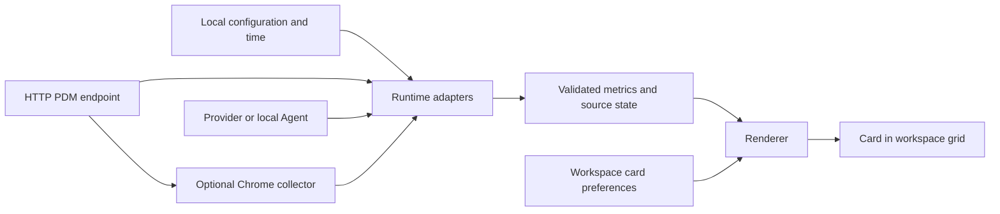

# Architecture

[Development](DEVELOPMENT.md) · [中文开发指南](DEVELOPMENT.zh-CN.md) · [Extending Progress](EXTENDING.md)

Progress v0.6.5 is a React/TypeScript application with browser-local workspace storage. Optional Node agents support local connections and device pairing; an optional Chrome extension supplies background HTTP collection. The hosted Web app is static.

## Data flow and ownership

Progress owns validation, collection lifecycle, freshness, formatting, storage, navigation and card interaction. Source-specific business rules belong to adapters or upstream services. A renderer consumes normalized data; it does not make network requests or invent task completion.

| Layer | Model / identity | Owns |
| --- | --- | --- |
| Component | `Component`, identified by `manifest.id` | Runtime declaration, configuration schema, optional static metrics and supported layouts |
| Instance | `Instance`, refers to `componentId` | User configuration, connection references and local collection consent |
| Metric | `Metric`, stable `id` within an instance | A PDM reading with meaning, lifecycle and freshness metadata |
| Card | `Card`, refers to `instanceId` + `metricId` | Renderer, color, display preferences, folder and layout |

One instance can supply several metrics and several cards. Editing shared instance configuration affects its cards. Card layout changes must leave instance configuration and metric values intact. Groups in `cardGroups.ts` reference existing card IDs; members retain their underlying instances and metrics. Removing the last card for an instance removes that unused instance and prunes its unused connection references, while the component remains installed.

Types live in [`model.ts`](../src/core/model.ts). [`validation.ts`](../src/core/validation.ts) validates component/workspace structure, configuration and relationships; [`metrics.ts`](../src/core/metrics.ts) validates and normalizes PDM. JSON schemas in [`spec/`](../spec/) describe formats, while runtime validation adds semantic checks. Schema filenames retain format versions, independently of the app version.

## Startup and configuration

[`main.tsx`](../src/main.tsx) loads saved data through `loadWorkspace`, falls back to `emptyWorkspace`, then calls `upgradeWorkspace`. The upgrade adds missing built-in definitions and connection/folder migrations while retaining installed component definitions and user data.

[`App.tsx`](../src/App.tsx) owns workspace state, navigation, editors, import confirmation and persistence status. A component configuration flow validates inputs, tests remote data when needed, selects metrics and creates or updates instances/cards. Installed declarations use the supported schema-generated form; the dedicated Codex/Provider flows handle connection setup.

A load error preserves the original saved value. The app displays a temporary empty workspace with automatic persistence disabled. Explicitly saving the current workspace or completing an import re-enables persistence. Keep this recovery behavior when changing storage or migrations.

## Collection lifecycle

[`runtime.ts`](../src/core/runtime.ts) calculates `manual`, `quota`, `time_range` and `static` readings locally. HTTP instances need network consent. Direct HTTP fetches omit cookies, reject redirects and use the shared [`httpResponse.ts`](../src/core/httpResponse.ts) parser, which enforces the 2 MB response limit and normalizes PDM.

[`useMetrics.ts`](../src/hooks/useMetrics.ts) manages per-instance snapshots, requests and deadlines. It avoids overlapping reads for one source, cancels obsolete work on cleanup, pauses new reads while the document is hidden, and refreshes on visibility/online recovery. HTTP reads time out after 10 seconds; quota/connection reads use 15 seconds. Failure backoff grows from the configured interval, capped at 20 times that interval and one day. A manual refresh clears the deadline; an active read can queue another refresh.

A `Snapshot` contains metrics plus loading/error and receipt metadata. [`sourceState.ts`](../src/core/sourceState.ts) derives user-facing connection/freshness states separately from the metric's business `status`. Collection failure generally retains the last successful sample. Account mismatch is different: the old account's sample is cleared and confirmation is required.

PDM semantics are documented in [PDM](PDM.md). Missing totals or invalid readings must not become fabricated percentages or zero values. `meaning=completed` describes the quantity; `status=completed` declares lifecycle completion. Formatting and completion rules live in [`presentation.ts`](../src/core/presentation.ts).

## Providers and local agents

[`providers.ts`](../src/core/providers.ts) discovers built-in and installed provider declarations, reads direct or relay connections and selects an eligible source. Source signatures/cache keys include connection context; `newestSnapshot` prevents a delayed sample from replacing newer observed data. Keep independent quota windows and original timestamps.

[`scripts/codex-agent.mjs`](../scripts/codex-agent.mjs) starts the installed Codex app-server and exposes a restricted loopback HTTP bridge. Codex retains its credentials; the bridge returns whitelisted, masked account/usage data. [`codex.ts`](../src/core/codex.ts) adapts that data and enforces the account binding. Installing a declaration cannot create a working integration for an unsupported service.

[`scripts/pairing-agent.mjs`](../scripts/pairing-agent.mjs) owns device identity, source approval, encrypted relay traffic and revocation. [`pairing.ts`](../src/core/pairing.ts) is the Web client. A pairing code discovers a local source; the owner must approve the device before it reads samples. This is a local device flow, with no hosted Progress account or cloud synchronization service. See the [provider/pairing contract](../spec/Provider_Pairing_Contract_v0.5.md).

Vite supplies agent middleware during development. The desktop launcher supplies it alongside built Web files. Static hosting and `pnpm preview` do not provide those routes; see [execution modes](DEVELOPMENT.md#commands-and-execution-modes).

## Storage and portability

| Data | Location | Export behavior |
| --- | --- | --- |
| Workspace configuration | Browser `localStorage` key `progress.workspace.v1`; Capacitor Preferences on native platforms | Sanitized through `portableWorkspace` |
| Device credentials, non-extractable encryption key, pairing client state and connection sample caches | IndexedDB `progress-device-vault`, store `records` | Outside workspace exports |
| Legacy local Codex samples | `localStorage` prefix `progress.codex.sample.v1.`, account-keyed and masked | Outside workspace exports |
| Pairing Agent identity, device bindings and encrypted upstream state | Local `.progress-agent/` or `PROGRESS_AGENT_HOME` | Outside workspace exports and ignored by Git |
| Chrome approved endpoints, source schedules and collected samples | Extension `chrome.storage.local` | Outside workspace exports |

[`storage.ts`](../src/core/storage.ts) serializes writes through a queue. [`vault.ts`](../src/core/vault.ts) encrypts saved credential strings with AES-GCM and a non-extractable device key; ordinary records and sample caches are not all encrypted. This is device-local storage, not an independent protection boundary against scripts executing in the same origin.

[`packages.ts`](../src/core/packages.ts) reads/writes three formats:

| Format | Contents |
| --- | --- |
| `.progressmod` | ZIP with `manifest.json`, `config.schema.json` and optional `data.json` |
| `.progress` | Workspace JSON |
| `.progresspack` | ZIP containing `workspace.json` |

Imports validate structure/references before applying data; workspace imports use a confirmation/conflict flow. ZIP handling limits compressed and declared uncompressed size to 8,000,000 bytes, rejects traversal paths and allows at most 100 entries. These are prototype resource limits, not a general executable-plugin sandbox.

`portableWorkspace` preserves presentation, both layout profiles and connection relationships. It removes credential references, connection endpoints/account bindings, network/background consent and device-specific connection fields, marks connections for reconnection, and clears Codex account configuration. It rejects known credential-shaped legacy configuration. Ordinary HTTP instance URLs remain configuration: private endpoints can still be sensitive, so use synthetic exports for public examples.

## Layout and rendering

[`grid.ts`](../src/core/grid.ts) resolves capacity from the actual canvas, chooses a supported integer-span variant and performs placement/local collision reflow. The official layout set contains the sixteen rectangular sizes from 1×1 through 4×4. Component-specific declarations may provide a subset and deterministic fallback chains.

[`useLayoutProfile.ts`](../src/hooks/useLayoutProfile.ts) selects mobile at viewport width ≤680, or with a coarse pointer and short edge ≤680. Mobile canvases ≤520 use four columns with 6px gaps; wider mobile canvases can use more columns. Profile selection and actual canvas capacity are separate decisions.

Existing `layout.variant`, `position` and `horizontalPosition` fields describe desktop layout. `layout.mobile` has its own variant and positions. Legacy data without mobile hints falls back to the existing layout until separate hints are generated. Groups follow the same profile model. Copy/move retains size preferences while clearing destination positions.

[`WorkspaceGrid.tsx`](../src/ui/WorkspaceGrid.tsx) coordinates pointer/touch editing; [`OperationLayer.tsx`](../src/ui/OperationLayer.tsx) presents context operations. Held drag/resize blocks native pan only during the active gesture. Grouping uses a fixed 24px inset on all edges plus a 420ms dwell. Keep direct configuration, long-press/right-click menus and non-drag alternatives.

[`ConfiguredContent.tsx`](../src/ui/ConfiguredContent.tsx), [`MetricView.tsx`](../src/ui/MetricView.tsx) and [`QuotaView.tsx`](../src/ui/QuotaView.tsx) render selected data. [`useCardContentGuard.ts`](../src/ui/useCardContentGuard.ts) measures actual content bounds and hides whole optional fields when space is insufficient. Saved display preferences survive that temporary budgeting.

## Optional Chrome transport

[`extension.ts`](../src/core/extension.ts) communicates with a narrowly scoped page bridge. The MV3 worker/collector schedules approved HTTP sources with Chrome alarms and caches normalized samples. Both a complete endpoint allowlist and Chrome host permission are required. Network/background consent is local and removed from portable packages.

The collector requires Chrome to be running, does not execute remote jobs, and provides no mobile background service. Custom deployment origins need explicit changes to the manifest and worker owner allowlist. Installation, permissions and real-browser acceptance are documented in [Chrome background collection](Chrome_Background.md) and [Testing](TESTING.md).
